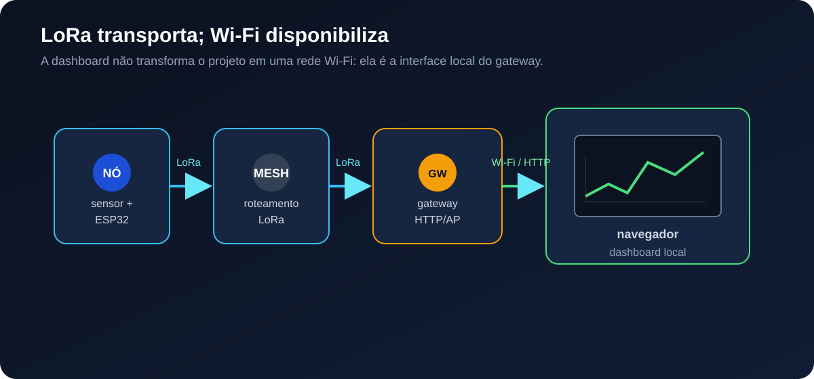
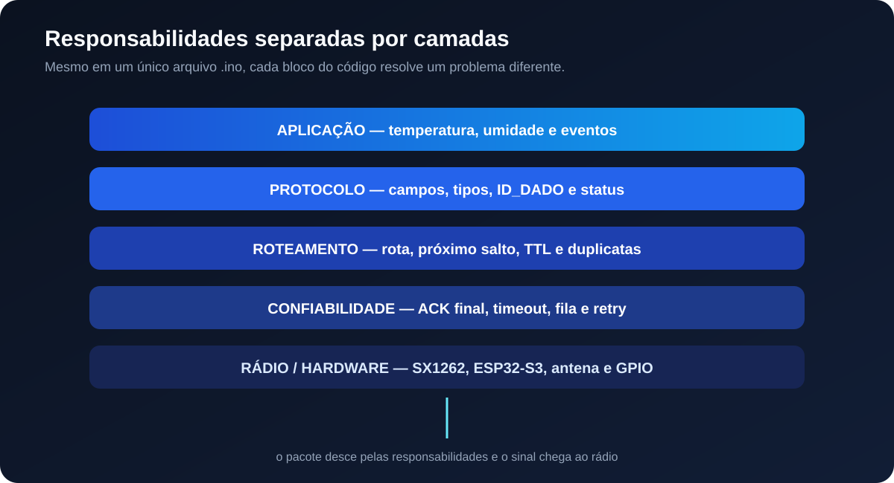
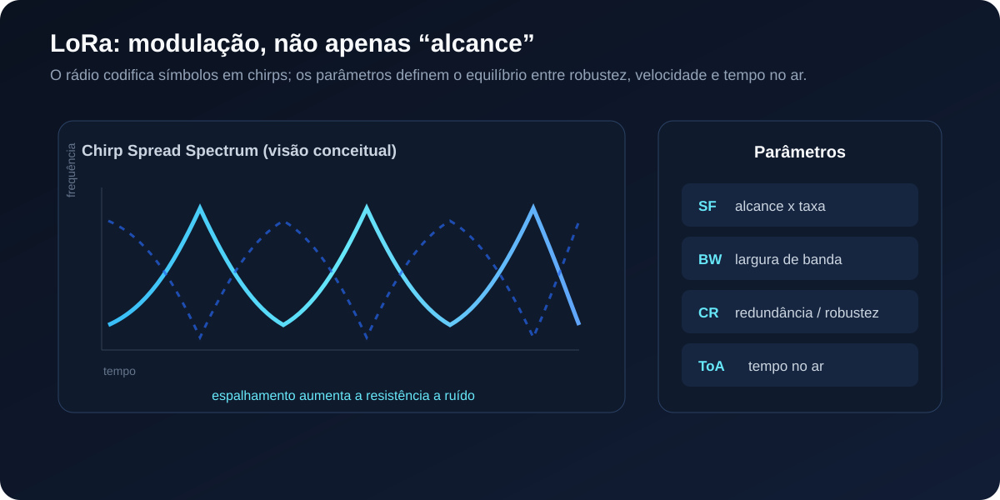
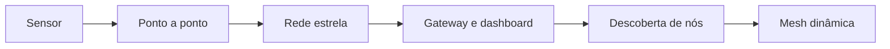
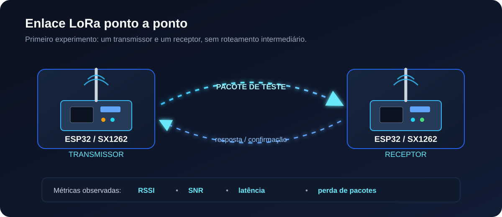
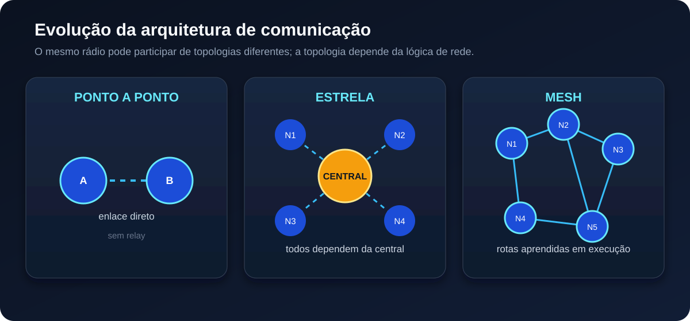
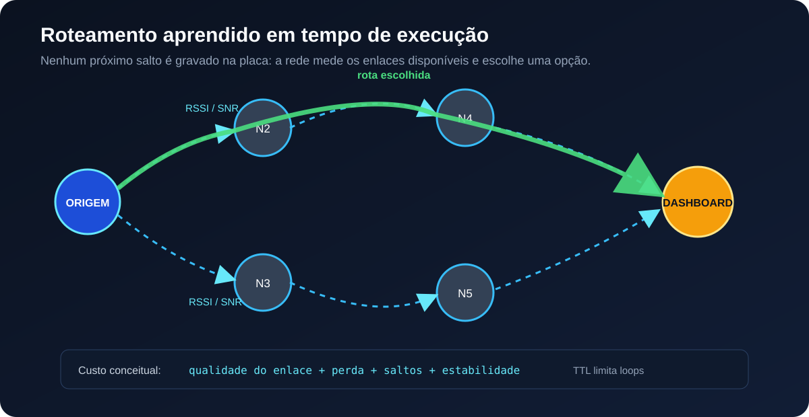
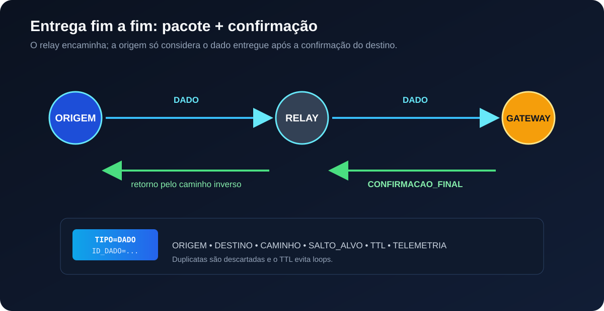

# Metodologia de desenvolvimento e avaliação de uma rede mesh LoRa baseada em ESP32

## Protocolo de Comunicação e Roteamento Mesh (PCRM)

## Resumo

Este repositório documenta o desenvolvimento experimental de uma infraestrutura de comunicação sem fio formada por dispositivos ESP32 equipados com rádio LoRa. O trabalho parte da avaliação de um enlace ponto a ponto, evolui para uma arquitetura centralizada e chega à proposta de uma rede mesh com descoberta automática de nós, seleção dinâmica de rotas, encaminhamento de pacotes e confirmação de entrega.

A metodologia foi organizada para separar os problemas de hardware, rádio, protocolo e aplicação. Primeiro são verificadas a leitura do sensor e a comunicação entre dois dispositivos. Em seguida são avaliados os efeitos da distância, da qualidade do sinal, do tamanho das mensagens, do número de saltos e das retransmissões. Por fim, os mecanismos são integrados em uma rede mesh com gateway e dashboard web local.


Palavras-chave: redes sem fio; LoRa; ESP32; SX1262; comunicação ponto a ponto; rede mesh; roteamento; protocolos; sistemas embarcados.

---

## 1. Introdução

Uma rede de comunicação é formada por dispositivos que trocam informações segundo regras previamente definidas. Essas regras determinam como os dados são representados, transmitidos, recebidos, confirmados, encaminhados e descartados quando ocorre uma falha.

Em um sistema embarcado, a comunicação não depende somente do sensor ou do microcontrolador. É necessário considerar o meio físico, o rádio, a codificação da mensagem, o controle de acesso ao canal, a identificação dos dispositivos e o comportamento da aplicação quando o pacote não chega ao destino.

Este trabalho utiliza placas Heltec WiFi LoRa 32 V3, baseadas em ESP32-S3 e rádio SX1262, para investigar esses elementos em uma rede de baixa taxa de dados. O foco está na construção e na avaliação de uma infraestrutura de comunicação: como dois dispositivos estabelecem um enlace, como vários dispositivos podem compartilhar uma central e como a rede pode encaminhar dados por caminhos alternativos.

O protocolo desenvolvido para a camada de aplicação é denominado PCRM — Protocolo de Comunicação e Roteamento Mesh. Ele não substitui a modulação LoRa; sua função é organizar os dados e definir o comportamento dos nós acima do rádio.



### 1.1 Problema investigado

Em uma comunicação direta, o transmissor precisa alcançar o receptor por um único enlace. Quando a distância, os obstáculos ou a qualidade do canal impedem essa comunicação, outro dispositivo pode ser utilizado como encaminhador. Nesse caso, o problema deixa de ser apenas transmitir uma mensagem e passa a envolver:

- descoberta de vizinhos;
- escolha do próximo salto;
- identificação da origem e do destino;
- prevenção de loops;
- controle de mensagens duplicadas;
- controle do tempo de espera;
- confirmação de recebimento;
- recuperação de uma rota que deixou de responder.

A questão central da metodologia é verificar em que condições uma rede mesh baseada em LoRa consegue transportar mensagens de forma organizada, mensurável e reproduzível.

### 1.2 Objetivo geral

Desenvolver e avaliar um protocolo de comunicação e roteamento para uma rede mesh de dispositivos ESP32 com rádio LoRa, observando a relação entre qualidade do enlace, número de saltos, tamanho dos pacotes, tempo de resposta e taxa de entrega.

### 1.3 Objetivos específicos

1. Verificar o funcionamento do sensor e do hardware de cada nó.
2. Avaliar a comunicação LoRa ponto a ponto.
3. Registrar RSSI, SNR, latência e perda de pacotes.
4. Comparar as arquiteturas ponto a ponto, estrela e mesh.
5. Implementar mensagens de presença e descoberta de rotas.
6. Definir um formato de pacote capaz de transportar origem, destino, caminho e dados.
7. Implementar confirmação de entrega por identificador de mensagem.
8. Avaliar o efeito do tamanho dos pacotes e dos múltiplos saltos.
9. Disponibilizar os dados em uma dashboard web hospedada pelo gateway.

---

## 2. Fundamentação sobre redes e comunicação

### 2.1 Comunicação entre dispositivos

Comunicação é o processo de transportar uma informação de um ponto de origem para um ponto de destino. Para que o processo seja compreendido pelos dois lados, os dispositivos precisam concordar sobre pelo menos quatro aspectos:

1. representação dos dados;
2. identificação dos participantes;
3. momento e forma da transmissão;
4. resposta esperada após o recebimento.

Uma mensagem transmitida pelo rádio é apenas uma sequência de símbolos. O significado de cada campo depende do protocolo utilizado pela aplicação. Por exemplo, o texto `TEMP=25.4` só representa uma temperatura porque o software do receptor conhece o campo `TEMP`.

### 2.2 Enlace, rede e aplicação

Os termos abaixo representam responsabilidades diferentes:

| Camada conceitual | Responsabilidade | Exemplo neste trabalho |
|---|---|---|
| Meio físico | Propagação do sinal eletromagnético. | Antena, frequência e ambiente. |
| Enlace | Troca de quadros entre rádios próximos. | Transmissão e recepção pelo SX1262. |
| Rede | Encaminhamento entre vários dispositivos. | Descoberta e seleção de rotas. |
| Transporte/confiabilidade | Controle de perda e confirmação. | Timeout, retry e confirmação final. |
| Aplicação | Interpretação do conteúdo. | Temperatura, umidade e eventos. |
| Interface | Apresentação das informações. | Dashboard HTTP no gateway. |

As camadas não significam necessariamente arquivos separados. Na versão monolítica, elas são blocos de responsabilidade dentro do mesmo programa C++. A separação conceitual permite analisar cada problema sem confundir uma falha do sensor com uma falha do rádio, por exemplo.



### 2.3 Ponto a ponto, estrela e mesh

As topologias descrevem como os dispositivos se relacionam.

Na topologia ponto a ponto, existem dois participantes e um enlace direto. Na topologia estrela, vários nós dependem de uma central. Na topologia mesh, os nós podem encaminhar mensagens entre si e formar caminhos com múltiplos saltos.

A topologia não é definida somente pelo rádio. Duas placas com o mesmo SX1262 podem participar de uma comunicação ponto a ponto, de uma estrela ou de uma mesh, dependendo das regras implementadas no firmware.

---

## 3. LoRa e rede LoRa

### 3.1 O que é LoRa

LoRa é uma tecnologia de modulação de radiofrequência baseada em Chirp Spread Spectrum (CSS). Na modulação CSS, a informação é representada por símbolos associados a sinais cuja frequência varia ao longo do tempo, chamados chirps.

Essa característica permite que o receptor identifique a estrutura do sinal mesmo quando a potência recebida é baixa ou existe ruído. A técnica favorece sensibilidade e alcance relativo, mas não foi criada para oferecer a mesma taxa de dados de tecnologias como Wi-Fi.

O desempenho de um enlace LoRa resulta da combinação entre:

- frequência da portadora;
- largura de banda;
- spreading factor;
- coding rate;
- potência de transmissão;
- sensibilidade do receptor;
- antena;
- obstáculos e características do ambiente;
- ocupação e interferência no canal.

O ganho de alcance não vem simplesmente de aumentar a potência. Um spreading factor maior pode tornar o sinal mais robusto, mas também aumenta o tempo no ar e reduz a taxa de transmissão.



### 3.2 O que é uma rede LoRa

Uma rede LoRa é formada por dispositivos que utilizam a modulação LoRa para trocar dados e por um conjunto de regras que define como essas trocas acontecem.

A modulação permite transportar os bits. O protocolo de rede define, entre outras coisas, quem originou a mensagem, para quem ela deve ir, quais nós podem encaminhá-la e como o sistema identifica uma falha.

Neste trabalho, a rede é construída diretamente sobre o rádio SX1262. A lógica de descoberta, roteamento e confirmação pertence ao PCRM.

### 3.3 LoRa, protocolo LoRa e LoRaWAN

É comum utilizar a expressão “protocolo LoRa” de maneira genérica. Tecnicamente, LoRa identifica principalmente a camada física de modulação. O protocolo completo depende da solução de rede utilizada sobre essa camada.

| Termo | Definição | Utilização neste trabalho |
|---|---|---|
| LoRa | Modulação de rádio CSS. | Utilizada pelo SX1262. |
| Rede LoRa | Rede de dispositivos que usa LoRa para trocar mensagens. | É a infraestrutura formada pelos nós. |
| LoRaWAN | Protocolo padronizado para redes LPWAN com gateways e servidores de rede. | Não é implementado neste repositório. |
| PCRM | Protocolo de aplicação e roteamento desenvolvido para o experimento. | Define mensagens, rotas, filas e confirmações. |

No LoRaWAN, o gateway normalmente faz a ponte entre os pacotes de rádio e um servidor de rede conectado por IP. No PCRM, os próprios ESP32 podem participar do encaminhamento de uma mensagem até o gateway, formando uma rede mesh de múltiplos saltos.

---

## 4. ESP32, rádio LoRa e sensores

### 4.1 ESP32

O ESP32 é o microcontrolador responsável por executar o firmware. Ele controla os sensores, organiza os dados, opera o display, controla o rádio e executa o protocolo de comunicação.

O ESP32, sozinho, não é um rádio LoRa. Para transmitir por LoRa é necessário um transceptor LoRa conectado ao microcontrolador. Na placa Heltec WiFi LoRa 32 V3, esse transceptor é o SX1262.

Essa distinção é importante: o Wi-Fi do ESP32 e o rádio LoRa da Heltec são interfaces diferentes, com finalidades diferentes. O Wi-Fi é utilizado neste trabalho para acessar a dashboard do gateway. A comunicação entre os nós da mesh utiliza o SX1262.

### 4.2 SX1262

O SX1262 é o transceptor de radiofrequência utilizado para os enlaces LoRa. O firmware configura seus pinos SPI e seus parâmetros de transmissão por meio da biblioteca RadioLib.

O rádio trabalha em half-duplex. Enquanto transmite, não recebe simultaneamente pelo mesmo canal. Por isso, o software precisa alternar entre recepção, transmissão, espera, fila e processamento de confirmações.

### 4.3 Sensores e dados de aplicação

O DHT22 é utilizado como sensor de teste para gerar valores de temperatura e umidade do ar. A aplicação pode ser ampliada para outros sensores, mas o funcionamento do sensor não deve ser confundido com o funcionamento da rede.

A sequência de diagnóstico deve ser:

1. validar a ligação elétrica;
2. validar a leitura no Monitor Serial;
3. testar a transmissão de uma mensagem fixa;
4. testar a transmissão dos dados do sensor;
5. testar o encaminhamento e a confirmação.

---

## 5. Parâmetros do enlace utilizado

A configuração de referência do protótipo monolítico é:

| Parâmetro | Valor configurado | Consequência para o experimento |
|---|---:|---|
| Frequência | 915 MHz | Define a portadora utilizada pelo rádio. |
| Largura de banda | 125 kHz | Influencia taxa, robustez e ocupação espectral. |
| Spreading factor | SF9 | Aumenta a robustez e o tempo no ar em relação a SF menores. |
| Coding rate | 4/5 | Adiciona redundância para correção de erros. |
| Preâmbulo | 12 símbolos | Auxilia a sincronização do receptor. |
| Potência | 17 dBm | Define a potência configurada para transmissão. |
| Pacote máximo do protocolo | 240 bytes | Impede o uso de mensagens excessivamente grandes. |

Esses valores são parâmetros experimentais, não características obrigatórias de toda rede LoRa. Todas as placas que participam de um mesmo enlace precisam utilizar configurações compatíveis.

### 5.1 RSSI

RSSI é o indicador de potência do sinal recebido. Como a medição normalmente aparece em dBm negativos, um valor mais próximo de zero representa um sinal mais forte. Assim, `-60 dBm` indica maior potência recebida do que `-80 dBm`.

RSSI não é uma medição direta de distância. Reflexões, obstáculos, orientação da antena, ruído e alimentação podem modificar o valor. Por esse motivo, a distância deve ser medida fisicamente e o RSSI deve ser tratado como uma métrica de qualidade do enlace.

### 5.2 SNR

SNR é a relação entre sinal e ruído. Ele complementa o RSSI porque dois sinais podem apresentar potências parecidas, mas níveis de ruído diferentes.

O PCRM utiliza RSSI e SNR para construir uma avaliação heurística do enlace. A escolha definitiva de uma rota deve considerar também perda de pacotes, número de saltos e estabilidade ao longo do tempo.

---

## 6. Metodologia experimental

O trabalho utiliza uma abordagem experimental e incremental. Cada etapa adiciona uma responsabilidade somente depois que a etapa anterior pode ser observada e avaliada.

### 6.1 Variáveis observadas

As principais variáveis de análise são:

- distância entre as placas;
- frequência;
- largura de banda;
- spreading factor;
- coding rate;
- potência de transmissão;
- RSSI;
- SNR;
- tamanho do pacote;
- quantidade de saltos;
- tempo entre transmissão e confirmação;
- quantidade de pacotes perdidos;
- quantidade de retransmissões;
- disponibilidade de cada nó.

### 6.2 Etapas da metodologia



Cada etapa responde a uma pergunta específica:

| Etapa | Pergunta de validação |
|---|---|
| Sensor | O dispositivo mede e informa valores válidos? |
| Ponto a ponto | Dois rádios conseguem trocar mensagens? |
| Estrela | Vários nós conseguem alcançar uma central? |
| Gateway | A central consegue receber e apresentar os dados? |
| Descoberta | A rede reconhece nós sem cadastro manual? |
| Mesh | A mensagem consegue seguir por caminhos alternativos? |

---

## 7. Primeira etapa: comunicação ponto a ponto

Na comunicação ponto a ponto, um ESP32 transmite diretamente para outro ESP32 equipado com rádio LoRa. Não há roteador, relay ou gateway intermediário.

Essa etapa é necessária porque permite avaliar o enlace antes da introdução de variáveis de roteamento. Caso a comunicação direta falhe, ainda não é possível concluir que o problema está na mesh.



### 7.1 Procedimento

1. Programar uma placa como transmissora.
2. Programar outra placa como receptora.
3. Configurar os dois rádios com os mesmos parâmetros.
4. Transmitir mensagens com identificador sequencial.
5. Registrar o recebimento no Monitor Serial.
6. Medir RSSI, SNR e tempo de resposta.
7. Repetir o teste em diferentes distâncias e posições.
8. Calcular a proporção entre mensagens enviadas e recebidas.

### 7.2 Registro do alcance

O alcance deve ser apresentado como resultado de medição, com a configuração utilizada, a antena, a altura, o ambiente e a taxa de perda. Não se deve substituir o alcance observado por uma distância teórica informada pelo fabricante.

| Configuração | Distância | Pacotes enviados | Pacotes recebidos | Perda | RSSI médio | SNR médio |
|---|---:|---:|---:|---:|---:|---:|
| 915 MHz / SF9 / BW125 | a preencher | a preencher | a preencher | a calcular | a medir | a medir |

---

## 8. Segunda etapa: rede estrela e gateway

Na rede estrela, os nós transmitem diretamente para uma central. A central recebe os pacotes e pode disponibilizá-los em uma interface web.

```text
Nó 1 ─┐
Nó 2 ─┼──> Central LoRa ──> Wi-Fi/HTTP ──> Navegador
Nó 3 ─┘
```

A estrela é uma etapa de integração. Ela adiciona uma central e uma dashboard, mas ainda não exige que um nó encaminhe a mensagem de outro.

Essa arquitetura permite verificar:

- se vários transmissores podem compartilhar o canal;
- se a central identifica a origem de cada mensagem;
- se os dados são armazenados em uma estrutura de estado;
- se o navegador consegue consultar a dashboard;
- se a central consegue anunciar sua presença.



---

## 9. Terceira etapa: rede mesh

Na rede mesh, qualquer nó pode originar uma mensagem ou encaminhar uma mensagem recebida. A comunicação não precisa começar em um dispositivo específico e não depende de uma ordem fixa de placas.

Uma rota possível é:

```text
Nó A → Nó C → Nó E → Gateway
```

Outra rota pode ser escolhida quando a primeira apresenta falha:

```text
Nó A → Nó B → Nó D → Gateway
```

O próximo salto, o salto anterior e o caminho devem ser obtidos durante a execução. A definição manual desses valores transformaria a rede em uma cadeia fixa.

### 9.1 Descoberta de presença

Cada dispositivo transmite periodicamente uma mensagem de anúncio. A dashboard pode registrar a identidade, o último contato, RSSI, SNR, quantidade de saltos e estado do nó.

Quando uma identidade ainda não conhecida aparece, a central cria um registro. Quando o intervalo de presença é excedido, o nó pode ser marcado como offline.

### 9.2 Descoberta de rota

Quando um nó precisa enviar uma mensagem e não possui uma rota válida, inicia uma busca. A mensagem de busca carrega um caminho parcial e um custo acumulado. Os nós intermediários podem encaminhar a busca, desde que ainda não estejam no caminho.

Quando a busca alcança o destino, uma resposta percorre o caminho inverso. A origem armazena a rota aprendida e utiliza o próximo salto indicado para transmitir o dado.



---

## 10. Estrutura do protocolo PCRM

O protocolo de aplicação utiliza mensagens textuais com campos separados por ponto e vírgula. Essa escolha facilita a análise pelo Monitor Serial durante a fase experimental.

Exemplo de mensagem de dados:

```text
TIPO=DADO;ORIGEM=N_A1B2C3D4;DESTINO=N_F5E6D7C8;ID_DADO=DADO-N_A1B2C3D4-4;CAMINHO=N_A1B2C3D4>N_11223344>N_F5E6D7C8;SALTO_ALVO=N_11223344;TTL=8;TEMP=25.40;UMID_AR=61.20;EVENTO=NORMAL
```

### 10.1 Campos

| Campo | Função |
|---|---|
| `TIPO` | Identifica a operação da mensagem. |
| `ORIGEM` | Identifica o nó que criou o pacote. |
| `DESTINO` | Identifica o destino final. |
| `ID_DADO` | Distingue uma mensagem de todas as outras. |
| `CAMINHO` | Registra a sequência de nós da rota. |
| `SALTO_ALVO` | Define qual nó deve processar o pacote naquele momento. |
| `TTL` | Limita a quantidade de encaminhamentos. |
| `TEMP` | Valor de temperatura da aplicação. |
| `UMID_AR` | Valor de umidade do ar da aplicação. |
| `EVENTO` | Informação complementar produzida pelo nó. |

### 10.2 Tipos de mensagem

Os principais tipos utilizados ou previstos são:

```text
ANUNCIO_DASHBOARD
ANUNCIO_NO
BUSCA_ROTA
ROTA_ENCONTRADA
DADO
CONFIRMACAO_FINAL
CONFIRMACAO_PRESENCA
```

Os nomes `BUSCA_ROTA` e `ROTA_ENCONTRADA` representam, em português, a função de uma requisição e de uma resposta de rota. Protocolos conhecidos, como AODV, são referências conceituais; a implementação do PCRM possui estrutura própria.

### 10.3 Identificação automática

Cada placa gera uma identidade interna a partir do identificador de hardware do ESP32, produzindo uma identificação no formato:

```text
N_XXXXXXXX
```

Essa identidade não depende de atribuir manualmente `ESP_01`, `ESP_02` ou `ESP_03`. A configuração do papel da placa é separada da identidade:

```cpp
constexpr bool EH_DASHBOARD = false;
```

O valor `false` indica um nó comum. O valor `true` indica a placa que executará também as funções de gateway e dashboard. O caminho da comunicação continua sendo descoberto pela rede.

---

## 11. Confirmação de entrega e ACK

ACK é a abreviação de *Acknowledgement*, ou confirmação de recebimento. No PCRM, a confirmação está associada ao identificador da mensagem para que a origem saiba qual pacote foi entregue.

O fluxo de entrega é:

1. a origem cria um `ID_DADO`;
2. a origem encontra uma rota;
3. o pacote é colocado na fila de transmissão;
4. cada relay verifica o destino do salto, o caminho, o TTL e a duplicidade;
5. o pacote chega ao destino final;
6. o destino cria uma `CONFIRMACAO_FINAL`;
7. a confirmação retorna pelo caminho inverso;
8. a origem libera o pacote somente quando recebe o mesmo `ID_DADO`.

Na implementação atual, a confirmação final é diferente de um ACK local de salto. O relay encaminha o pacote sem enviar uma confirmação completa de dados à origem a cada etapa. Existe também uma confirmação de presença para verificar a disponibilidade dos nós.

Essa decisão reduz o número de transmissões. Um ACK local por salto pode ser adicionado em uma versão futura, mas aumenta o tráfego, a latência e a ocupação do canal.



### 11.1 Timeout e retransmissão

Se a confirmação não chegar dentro do tempo estabelecido, a origem deve considerar que a entrega não foi comprovada. O protocolo pode então invalidar a rota, iniciar uma nova descoberta e realizar uma nova tentativa dentro do limite definido.

Parâmetros da versão monolítica:

```cpp
constexpr unsigned long TIMEOUT_ACK_DADO_MS = 15000UL;
constexpr uint8_t MAX_TENTATIVAS_DADO = 2;
```

O timeout deve ser analisado junto com o spreading factor, o tempo no ar, o número de saltos, os atrasos da fila e o backoff.

---

## 12. Seleção de rotas

Uma rota não deve ser escolhida somente pelo nó que apresenta o maior RSSI em uma única leitura. O valor recebido pode variar rapidamente e não mede distância de forma direta.

O PCRM considera, de forma experimental:

- RSSI;
- SNR;
- perda de pacotes;
- número de saltos;
- validade da rota;
- estabilidade do enlace;
- capacidade de o nó encaminhar a mensagem.

### 12.1 Qualidade do enlace

Na versão monolítica, RSSI e SNR são normalizados para produzir uma avaliação heurística:

```text
qualidade_rssi = limitar((RSSI + 120) / 65, 0, 1)
qualidade_snr  = limitar((SNR  + 12)  / 24, 0, 1)
qualidade      = 0,65 × qualidade_rssi + 0,35 × qualidade_snr
custo_enlace   = 1 / qualidade
```

O custo de uma rota é acumulado nos enlaces percorridos. Uma rota com mais saltos pode ser preferível quando seus enlaces são mais estáveis do que os de uma rota direta.

Essa fórmula é um critério experimental. Para uma avaliação mais rigorosa, a taxa de entrega deve ser calculada a partir de várias mensagens e incorporada ao custo da rota.

---

## 13. Influência dos saltos e do tamanho dos pacotes

### 13.1 Camadas de software

Adicionar funções ou separar o código em classes não aumenta automaticamente o tempo de transmissão. Uma camada de software pode apenas organizar responsabilidades.

O custo aparece quando a implementação adiciona bytes, processamento bloqueante, confirmações ou esperas ao fluxo de comunicação.

### 13.2 Múltiplos saltos

Em uma transmissão direta, o pacote ocupa o canal uma vez. Em uma rota com quatro saltos, o mesmo conteúdo precisa ser transmitido pelo menos quatro vezes. Cada salto também pode incluir espera de fila, backoff e processamento.

Uma aproximação do tempo total é:

```text
tempo_total ≈ soma(tempo_no_ar de cada salto)
              + espera da fila
              + backoff
              + retransmissões
```

Uma rota com mais saltos não é necessariamente pior. Enlaces curtos e estáveis podem apresentar taxa de entrega superior à de um enlace direto longo e instável. A escolha deve equilibrar confiabilidade e tempo de resposta.

### 13.3 Tamanho do pacote

Pacotes maiores tendem a permanecer mais tempo no ar. Isso aumenta a exposição a ruído, a chance de colisão e o custo de uma retransmissão.

O pacote textual facilita a inspeção, mas campos com nomes longos consomem mais bytes. Uma versão binária reduziria o tamanho da mensagem, porém exigiria uma ferramenta de decodificação para análise dos testes.

### 13.4 Colisões e interferência

LoRa não elimina a possibilidade de colisões. Se dois nós transmitirem ao mesmo tempo em condições incompatíveis, um ou ambos os pacotes podem não ser decodificados.

O PCRM utiliza fila, prioridades, intervalo mínimo entre transmissões e atraso aleatório para reduzir a probabilidade de transmissões simultâneas. Essas técnicas não substituem um controle de acesso ao meio completo, mas são adequadas para a etapa experimental.

---

## 14. Lógica de execução do firmware

### 14.1 Inicialização

Durante o `setup()`, o firmware:

1. inicia a comunicação serial;
2. calcula a identidade do hardware;
3. configura a OLED;
4. configura o sensor quando a placa é um nó comum;
5. configura o SPI e o SX1262;
6. inicia o Wi-Fi e o servidor HTTP quando a placa é dashboard;
7. anuncia a presença do gateway ou começa a anunciar a própria presença.

### 14.2 Laço principal

O `loop()` executa tarefas curtas e não deve ficar bloqueado aguardando uma rota indefinidamente:

```text
atender requisições HTTP
receber mensagens do rádio
processar anúncios e buscas de rota
ler o sensor no intervalo configurado
criar mensagens de dados
processar a fila de transmissão
verificar confirmações e timeouts
marcar nós offline quando necessário
```

Os intervalos são controlados por `millis()`. A página web pode atualizar a cada segundo sem obrigar o DHT22 a ser lido a cada segundo, pois o sensor possui uma limitação própria de leitura.

### 14.3 Fila e prioridades

As mensagens são organizadas em uma fila. Confirmações possuem prioridade maior do que uma telemetria comum, porque uma confirmação pode liberar uma mensagem pendente e evitar uma retransmissão desnecessária.

O atraso aleatório reduz a possibilidade de todos os nós transmitirem simultaneamente após receberem o mesmo anúncio.

### 14.4 Validação de mensagens

Antes de encaminhar um pacote, o nó verifica:

- se os campos obrigatórios existem;
- se o `SALTO_ALVO` corresponde ao próprio nó;
- se o caminho contém a identidade do nó;
- se o identificador já foi processado;
- se o TTL ainda permite encaminhamento;
- se existe um próximo nó no caminho.

Essa validação reduz loops, duplicatas e retransmissões indevidas.

---

## 15. Gateway e dashboard

A placa configurada como dashboard exerce duas funções:

1. recebe pacotes LoRa pelo SX1262;
2. disponibiliza os dados por HTTP usando o Wi-Fi.

O caminho da informação é:

```text
Sensor → ESP32 → mesh LoRa → gateway → Wi-Fi/HTTP → navegador
```

O Wi-Fi não é utilizado para transportar a mensagem entre os nós. Ele fornece o acesso à interface do gateway.

### 15.1 Modos de acesso

Quando `WIFI_LOCAL_SSID` está vazio, a placa pode criar o ponto de acesso `PCRM_DASHBOARD`. Quando os dados de uma rede local são preenchidos, a placa tenta conectar-se a essa rede e informa o endereço IP obtido.

### 15.2 Interface web

O servidor local utiliza a porta 80 e disponibiliza endpoints como:

```text
/api/status
/api/nos
```

O navegador consulta a API periodicamente e atualiza a tabela de nós, contendo informações como estado, RSSI, SNR, saltos e última leitura recebida.


---

## 16. Hardware e pinagem

Placa de referência: Heltec WiFi LoRa 32 V3, com ESP32-S3, OLED SSD1306 e SX1262.

### 16.1 Rádio SX1262

| Sinal | GPIO |
|---|---:|
| SCK | 9 |
| MISO | 11 |
| MOSI | 10 |
| NSS/CS | 8 |
| DIO1 | 14 |
| RESET | 12 |
| BUSY | 13 |

### 16.2 OLED

| Sinal | GPIO |
|---|---:|
| SDA | 17 |
| SCL | 18 |
| RESET | 21 |
| VEXT | 36 |

### 16.3 DHT22

Na versão monolítica, o DHT22 está ligado ao GPIO4:

```cpp
constexpr int PINO_DHT = 4;
```

O valor `4` representa o GPIO4; não é necessário utilizar `04`. O sketch histórico de teste serial pode utilizar outro pino, portanto a pinagem deve ser conferida na versão gravada.

---

## 17. Procedimento de testes

### Teste A — Sensor

Executar o sketch de teste do DHT22 e verificar se os valores são válidos no Monitor Serial. Esse teste isola a leitura do sensor do restante da rede.

### Teste B — Enlace ponto a ponto

Utilizar duas placas e transmitir mensagens sequenciais. Registrar:

| Métrica | Forma de registro |
|---|---|
| Distância | Medição física entre as placas. |
| Pacotes enviados | Contador no transmissor. |
| Pacotes recebidos | Contador no receptor. |
| Perda | Diferença entre enviados e recebidos. |
| RSSI | Valor informado pelo receptor. |
| SNR | Valor informado pelo receptor. |
| Latência | Tempo até a resposta ou confirmação. |
| Configuração | Frequência, BW, SF, CR e potência. |

### Teste C — Central

Configurar uma placa como dashboard e verificar a entrega direta de uma mensagem de um nó até a central.

### Teste D — Encaminhamento

Inserir pelo menos um relay entre a origem e o gateway. Confirmar que o pacote mantém sua origem e seu identificador, enquanto o `SALTO_ALVO` é atualizado para o próximo nó.

### Teste E — Confirmação final

Verificar se o gateway recebe o dado e se a `CONFIRMACAO_FINAL` retorna à origem pelo caminho inverso.

### Teste F — Falha de rota

Desligar um nó utilizado no caminho e observar se o timeout invalida a rota e inicia uma nova busca.

### Teste G — Entrada de um nó

Ligar um dispositivo ainda não registrado e verificar se sua identidade aparece automaticamente na dashboard.

### Teste H — Tamanho de pacote

Transmitir mensagens com diferentes tamanhos e comparar tempo no ar, taxa de entrega, latência e retransmissões.

---

## 18. Estrutura do repositório

As versões representam etapas diferentes da investigação. Elas não formam um único programa que deve ser compilado simultaneamente.

| Caminho | Finalidade |
|---|---|
| `PCRM_v0_1_ACK.ino` | Estudo inicial de confirmação entre dois nós. |
| `PCRM_v0_2_RETRANSMISSAO.ino` | Encaminhamento experimental por múltiplos saltos. |
| `PCRM_v0_4_MESH_GERAL.ino` | Base de mesh e descoberta de rotas. |
| `PCRM_v0_5_DESCoberta_NOS.ino` | Descoberta de presença e registro de nós. |
| `PCRM_v0_6_DASHBOARD_WEB.ino` | Integração da central com servidor web. |
| `PCRM_v0_6_Dashboard_Mesh/` | Organização modular do firmware. |
| `PCRM_v0_8_Monolitico/` | Versão consolidada em um único sketch para a Arduino IDE. |
| `assets/` | Imagens e diagramas utilizados nesta documentação. |
| `PCRM_contexto_autoral.md` | Registro das decisões e da evolução da arquitetura. |

A versão monolítica existe porque a Arduino IDE apresentou dificuldades quando o código foi separado em vários arquivos. A concentração em um `.ino` facilita a gravação durante os testes, mas as responsabilidades continuam separadas conceitualmente.

---

## 19. Como executar a versão monolítica

### 19.1 Dependências

- Arduino IDE;
- pacote de placas ESP32;
- RadioLib;
- DHT sensor library;
- Adafruit GFX;
- Adafruit SSD1306;
- Heltec WiFi LoRa 32 V3;
- antena compatível com o rádio utilizado.

### 19.2 Configurar a dashboard

Abrir `PCRM_v0_8_Monolitico/PCRM_v0_8_Monolitico.ino` e configurar:

```cpp
constexpr bool EH_DASHBOARD = true;
```

Depois:

1. selecionar a placa ESP32-S3 correspondente;
2. selecionar a porta serial;
3. compilar e gravar;
4. abrir o Monitor Serial em 115200 baud;
5. observar o endereço IP exibido na OLED ou no terminal;
6. conectar o computador ou celular à rede configurada;
7. abrir o IP no navegador.

### 19.3 Configurar um nó comum

Utilizar o mesmo sketch e deixar:

```cpp
constexpr bool EH_DASHBOARD = false;
```

Conferir o DHT22 no GPIO4 e gravar o firmware. Não é necessário configurar o próximo salto ou o caminho da mensagem. Essas informações pertencem ao processo de descoberta da rede.

---

## 20. Limitações

O sistema ainda é um protótipo experimental. As principais limitações são:

- a escolha de rota utiliza uma heurística de RSSI e SNR;
- RSSI e SNR não substituem estatísticas de entrega;
- ainda é necessário avaliar a rede com muitos nós transmitindo;
- a mensagem textual consome mais bytes que uma estrutura binária;
- o ACK final comprova o recebimento pelo gateway, não a persistência em servidor externo;
- a versão atual não implementa uma camada completa de autenticação e criptografia;
- os sketches históricos podem apresentar parâmetros e pinagens diferentes;
- a frequência e a potência devem ser verificadas conforme o hardware e a regulamentação aplicável;
- o alcance real depende da antena, do ambiente e da configuração do rádio.

As limitações são registradas para separar o que foi implementado do que ainda precisa ser medido ou desenvolvido.

---

## 21. Próximas etapas

1. Completar a tabela de resultados do enlace ponto a ponto.
2. Comparar SF7 e SF9 mantendo as demais variáveis constantes.
3. Medir o tempo no ar de pacotes com diferentes tamanhos.
4. Incorporar a taxa de entrega ao custo de rota.
5. Testar colisões com vários nós em transmissão.
6. Refinar a fila e o controle de acesso ao canal.
7. Validar a entrada e a remoção automática de nós.
8. Criar uma versão binária opcional do protocolo.
9. Adicionar integridade, autenticação e criptografia.
10. Persistir métricas em banco de dados ou servidor externo.
11. Modularizar novamente o código após a estabilização do protocolo.

---

## Referências técnicas

1. Semtech. [What is LoRa?](https://www.semtech.com/lora/what-is-lora)
2. Semtech. [LoRa and LoRaWAN](https://www.semtech.com/uploads/technology/LoRa/lora-and-lorawan.pdf)
3. LoRa Alliance. [LoRa and LoRaWAN](https://resources.lora-alliance.org/infographic/lora-and-lorawan)
4. RadioLib. [Biblioteca e exemplos para SX126x](https://github.com/jgromes/RadioLib)
5. RadioLib. [Exemplo de configuração do SX126x](https://github.com/jgromes/RadioLib/blob/master/examples/SX126x/SX126x_Settings/SX126x_Settings.ino)

---

## Autoria e organização

Responsável pelo desenvolvimento e pela definição da arquitetura: Anthony, estudante de Tecnologia em Análise e Desenvolvimento de Sistemas no IFPE.

As decisões de hardware, protocolo, roteamento, formato de mensagens, metodologia de testes e evolução da rede são registradas neste repositório como parte do desenvolvimento do PCRM.
